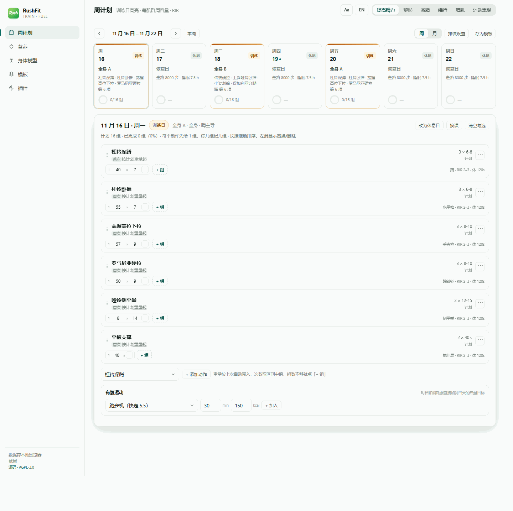
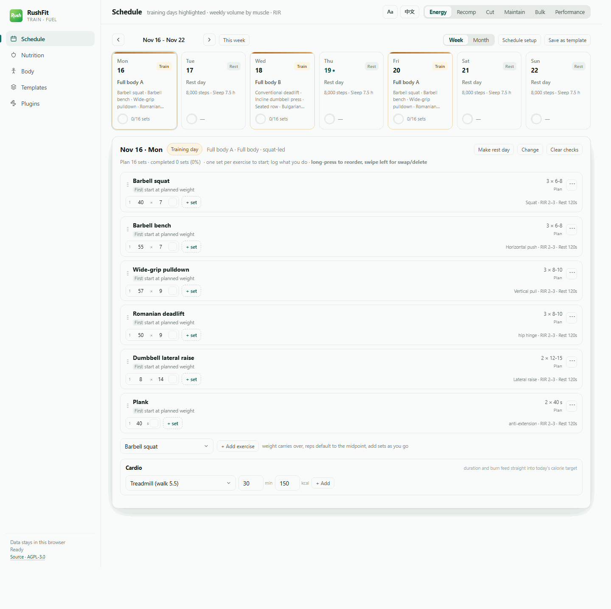

**English** · [中文](README.md)

# RushFit · Training & Nutrition

A **single-file, local-only** training and nutrition tool. Open it and it works — no account, no server, nothing uploaded.

> It started from a specific annoyance: lifting apps and diet apps are two separate things. You schedule leg day on one, and the other still suggests a low-carb rest day. RushFit lets **one goal drive both training and eating** — switch to "Bulk" and weekly sets per muscle, RIR, rest intervals, cardio, calories and carb timing all move together.

## Screenshots

**Schedule · Chinese UI**



**Schedule · English UI** — one tap to switch language, top right



## What it does

| Module | Details |
|---|---|
| **Schedule** | Week and month views, training days highlighted. Pick the session for any day (full-body A/B, upper/lower, push/pull/legs, or blank) and swap it later |
| **Logging** | Tick sets off, add or remove sets freely, weight and reps carry over from last time. Swipe left to swap or delete, long-press to reorder |
| **Progressive overload** | Each exercise shows "last 57 kg × 10, volume 1710 kg"; when you hit the top of the rep range it suggests "↑ try 62.5 kg" |
| **Volume by muscle** | Weekly effective sets for 8 muscle groups (direct + 0.5 × indirect) against your target range, with one-tap catch-up |
| **RIR & rest** | Target RIR and rest interval on every exercise; tap "Rest 120s" to start a countdown (floating bar, +30 s / skip, beep and vibration) |
| **Body model** | Weight, body fat, muscle mass and segmental data drive a figure plus FFMI / TDEE. Sex is selectable and the body-fat target is editable; activity is split into “daily activity (excl. training)” and “sessions per week” so a desk job can still train five times; works with incomplete data |
| **Nutrition** | Eaten / target / gap, with different targets on training and rest days; daily TDEE split so the weekly total is conserved; sodium tracked against a 5 g salt (2000 mg) ceiling — the sodium naturally present in foods is added automatically, salt and sauces are manual |
| **Nutrition score** | A 0–100 score from protein, calories, carbs, fat, fibre and sodium — undereating and overeating both lose points. The ring gives the total, with a one-line nudge that changes by score band (stable within a day); sodium is left out of the weighting until logged |
| **What you ate** | Every quick-add is kept and listed in order, so you can see the day's meals and remove a single entry (it is subtracted from the total) |
| **Balancer** | Pick the foods you actually have; a weighted least-squares solve returns grams. **Same input, same output, every time.** Lock a food and it stays put; portions can exclude meat at breakfast |
| **Method library** | 19 goal + split + prescription bundles, sorted by your current goal and marked ★; apply the whole thing or just the split |
| **Templates** | Save once, reuse for three months, with a review reminder |
| **Plugins** | Five built-in toggles (muscle tags on every exercise are **on by default**) and a tiny API to write your own |
| **English / 中文** | One-tap language switch in the top bar; the choice is remembered |

## Quick start

### On a computer
Download `index.html` and open it in any browser. Everything is stored in that browser's localStorage.

Deploy it (recommended — this is how phones get it)

```bash
git clone https://github.com/1Minmax1-hard/rushfit.git
cd rushfit
# Any static host works: GitHub Pages / Cloudflare Pages / Vercel / Netlify
```

**GitHub Pages**: Settings → Pages → Source `Deploy from a branch` → branch `main`, folder `/ (root)` → Save. You get <https://1minmax1-hard.github.io/rushfit/> in about a minute.

> The repository root is the folder containing `index.html` (this project's `public/` contents). Do not nest another `public/` inside, or the paths and `.github/FUNDING.yml` will break.

> GitHub Pages can be slow or unreachable from mainland China. Cloudflare Pages is usually steadier there; the code is identical.

> Note: in-app browsers (WeChat, Weibo, Instagram) have no "Add to Home Screen", so installing will fail there. Copy the link and open it in a real browser first.

### Install on iPhone / iPad (no App Store needed)

1. Open <https://1minmax1-hard.github.io/rushfit/> in **Safari** (recommended; since iOS 16.4 Chrome, Edge and Firefox work too, same steps. Use this web address, not the `github.com/.../rushfit.git` clone URL)
2. Tap the **Share** button
3. Choose **Add to Home Screen**

It then opens full-screen with no address bar, and **works offline** once loaded (cached by a service worker).

### Install on Android

Open <https://1minmax1-hard.github.io/rushfit/> in **Chrome** (recommended; other mainstream browsers work, but only Chrome — and Samsung Internet on Samsung phones — installs a real standalone app, while Firefox / Edge usually add a plain shortcut). Menu → **Install app** (or "Add to Home screen"). Offline works the same way.

### Backups

The Plugins page has **Export / Import**. Export weekly — browsers can evict localStorage (long periods without opening, or clearing site data). The export is a complete JSON file.

## Language

The **EN / 中文** button in the top bar switches the interface; the choice is stored locally.

- Chinese is the complete original version
- English covers the whole UI, terminology, exercise and food names, and every method's prescription and rationale; a few code-sample comments stay in Chinese
- Translation is a maintained text layer (`var EN = {...}`, keyed by the Chinese source string) — adding a new string means adding one dictionary entry, not touching every call site

## Data & privacy

- Everything is written to the current browser's `localStorage`, key `rushfit.v1`
- No network requests, no analytics SDK, no third-party scripts
- The app ships with **example data** (175 cm / 75 kg / 18%, male, 17% body-fat target) — change it in "Body model"; everything recalculates. Switching to female defaults the target to 24%, and you can still override it
- Changing browsers, clearing cache or uninstalling loses your data — use Export

## Data sources

- **USDA FoodData Central** — public domain (CC0 1.0), e.g. raw/cooked chicken breast (FDC 171077, 171477)
- **China Food Composition Tables, 6th ed.** — rice, noodles, beef, shrimp, eggs, vegetables, fruit (values cited with attribution; the table itself is not reproduced)
- **ISSN 2017 position stand** — protein 1.4–2.0 g/kg
- Training prescriptions follow Schoenfeld 2016/2017, Refalo 2023, Robinson 2024, Spiering 2021, Willis 2012, Wender 2022 and others; each is cited in the UI

## Disclaimer

This tool provides general training and nutrition information. It is **not medical advice** and does not replace a doctor or registered dietitian. If you have a medical condition, are taking medication, are pregnant, or are injured, consult a professional first. You use it at your own risk.

## Development

The whole app is one HTML file: styles in `<style>`, logic in `<script>`. No build step, no dependencies.

```
repo root/
├── index.html              # the app (markup + styles + logic + data)
├── manifest.webmanifest    # PWA manifest
├── sw.js                   # service worker (offline cache)
├── icons/                  # app icons
├── screenshots/            # README images
├── .github/FUNDING.yml     # sponsor links
├── LICENSE                 # full AGPL-3.0 text
├── README.md               # Chinese readme
└── README.en.md
```

**Writing a plugin** — append an object to the end of `<script>`; slots are `week` / `workout` / `nutrition`:

```js
registerPlugin({
  id: 'sodium',
  name: 'Sodium tracker',
  slot: 'nutrition',
  desc: 'High-sodium snacks cause water retention',
  render: function (el) {
    el.innerHTML = '<div class="chip">sodium ≈ 2200 mg / cap 2300 mg</div>';
  }
});
```

State is exposed as `window.RushFit.state`; read `S.logs` / `S.nut` directly.

## Supporting the project

If it helps you, you can buy me a coffee — **entirely optional, and it unlocks nothing**. Every feature is free either way.

**[→ Buy me a coffee (Afdian)](https://afdian.com/a/rushfit)**

GitHub Sponsors is also applied for; once approved, a **Sponsor** button appears in the top right of the repo. Neither channel unlocks anything.

No money is fine. These help more:

- **File an issue** — a wrong number, a confusing sentence, a missing exercise. That literally decides what gets fixed next
- **Star the repo** — it is how other people find it
- **Improve the wording** — the English copy is a maintained text layer; awkward phrases are welcome as PRs
- **Tell one friend who trains** — there is no marketing budget, only word of mouth

## License

[AGPL-3.0](LICENSE). Use it, modify it, redistribute it; if you run a **modified version as a network service**, publish your changes.

**Source**: <https://github.com/1Minmax1-hard/rushfit> — this repository is the complete Corresponding Source (`index.html`, `sw.js`, manifest, icons and the full license text; no build step, no hidden dependencies). The app's "Plugins · About" page and the sidebar footer both carry a clickable source link, which satisfies AGPL-3.0 §13's requirement to **prominently offer** the source:

- §13 binds licensees, not the original author, so the author owes nothing here; the links exist so downstream forks inherit the offer.
- If you fork and host this as a website, **keep and update** those two links so they point to the source of the version you actually run. Linking back to upstream alone does not satisfy §13.
- The app is purely local with no network interaction, so using it privately does not trigger §13. Hosting it for others does.
