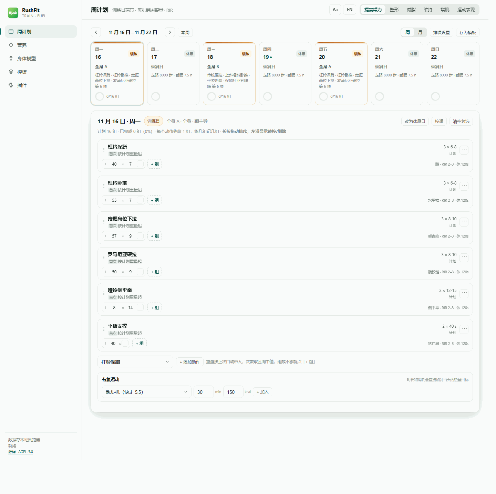
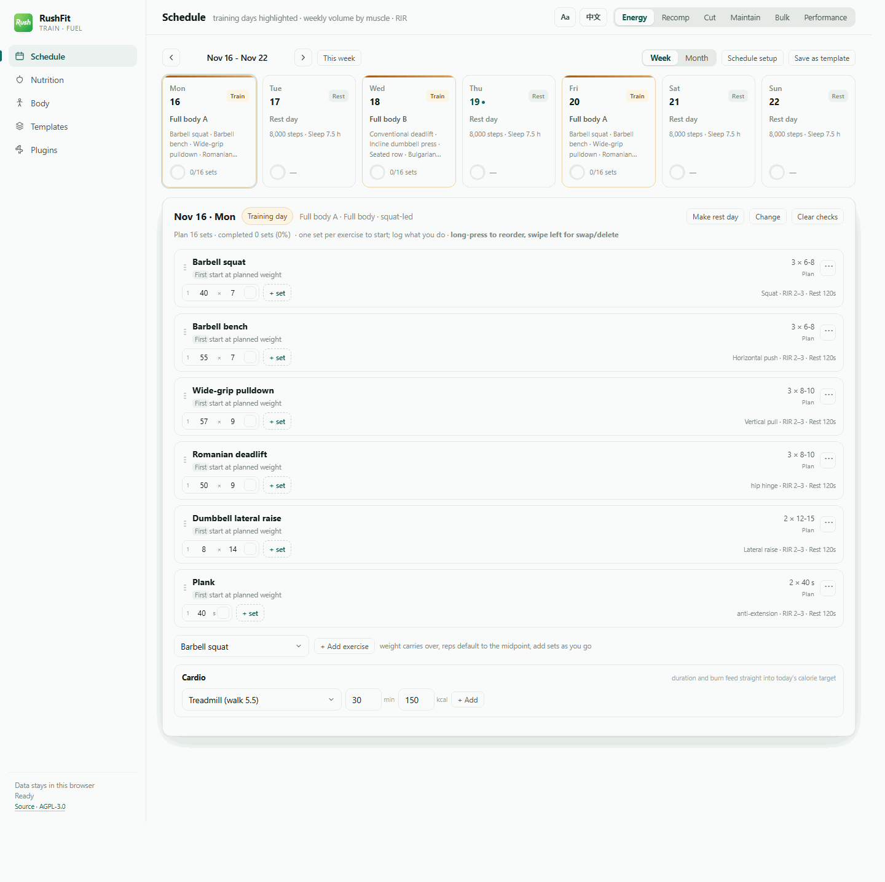

**中文** · [English](README.en.md)

# RushFit · 训练与营养

一个**单文件、纯本地**的训练与营养工具。打开就能用，没有账号、没有服务器、不上传任何数据。

> 做这个的起因很具体：市面上的训练 App 和饮食 App 是两套东西。你在这边排了腿，那边还在推荐高碳休息日。RushFit 让**一个目标同时驱动训练和吃法**——切到「增肌」，每肌群组数、RIR、组间休息、有氧、热量和碳水分配会一起变。

## 截图

**周计划 · 中文界面**



**Schedule · English UI**　右上角一键切换语言



## 它能做什么

| 模块 | 内容 |
|---|---|
| **新手指引** | 第一次打开（或指引本身更新过）自动走 6 步：选目标 → 挑训练法 → 导入身体数据 → 看今日摄入与评分 → 用「还差什么，怎么补」 → 排周计划。四周压暗、只亮要点，可跳过；想重看在「插件 · 关于 → 看新手指引」 |
| **健身目标** | 「模板」页第一张卡：减脂 / 塑形 / 增肌 / 维持 / 提高精力 / 运动表现，点一下整套重算热量、蛋白与碳水，下面紧接训练法库 |
| **周计划** | 周/月双视图，训练日高亮；每天可以单独选上哪节课（全身 A/B、上下肢、推拉腿或空白），也可随时换课 |
| **训练记录** | 每个动作勾选完成、任意加减组数、重量次数自动带入上次；左滑替换/删除，长按拖动排序 |
| **渐进超负荷** | 动作旁标「上次 57 kg × 10，容量 1710 kg」；做到区间上限时提示「↑ 可试 62.5 kg」 |
| **每肌群容量** | 8 个肌群的本周有效组数（直接 + 0.5×间接）对比目标区间，一键补齐到目标 |
| **RIR 与组间** | 每个动作标注 RIR 目标与组间休息，点「休 120s」直接开始倒计时（悬浮条 +30s / 跳过，结束响铃震动） |
| **身体模型** | 体重、体脂、肌肉量、分段数据驱动的人形图与 FFMI / TDEE；可选性别、体脂目标可调；活动拆成「日常活动（不含训练）」和「每周训练次数」两项分别选，久坐也能一周多练；缺数据也能用 |
| **营养追踪** | 已吃 / 应吃 / 差额，训练日与休息日目标不同；TDEE 按日拆分且周总量守恒；钠按 5 g 盐（2000 mg）上限追踪，食材自带的钠随快速记录自动累加，盐 / 酱油用调味料手填 |
| **改「已吃」** | 长按进度条 1 s 变粗并轻震，左右拖动即改数值（钠和热量按 5 跳，其余按 1）；不想拖就点旁边的加减，一律 ±1——电脑是上下箭头，手机在第一行是左右两个大按钮 |
| **营养评分** | 蛋白 / 热量 / 碳水 / 脂肪 / 纤维 / 钠六项加权算 0–100 分，吃少和吃多都扣分；环形图给出总分，旁边一句按分数档位变化的鼓励语（同一天内固定）；钠未记录时不参计分 |
| **吃了什么** | 每次快速记录都留档，按时间列出今天吃过的每一样，可单条删除并自动从当日摄入扣回 |
| **配平** | 勾选你手边的食材，加权最小二乘求一组克数，**同样的输入永远得到同样的输出**；克数锁定后不再改动（锁图标点一下切换）；食材可长按拖动排序、拖到页面顶端删除 |
| **自定义食材** | 入口在「快速记录」下面，填每 100 g 的营养即可；**加一次全局通用**——快速记录、配平、每日配额都能用，只有名字是你自己起的 |
| **改食材数值** | 长按「参与配平的食材」任意一颗进入编辑，点一下选中、按右上角「编辑」填新数值，保存即覆盖原来那条（内置的也能改，牛肉·瘦和牛肉·肥分开改）；点页面空白处结束编辑 |
| **训练法库** | 19 套「目标 + 分化 + 处方」，按当前目标排序并标 ★，可只换课表或整套套用 |
| **模板** | 存一次复用三个月，到期提醒复查 |
| **插件** | 内置 6 个可开关插件（「动作部位注释」默认开启；「每天该吃多少」默认关闭，打开后按目标反推每餐份量），并有注册接口可以自己写 |
| **导入数据** | 「设置 · 自己写」卡片里可以直接导入身体数据、自定义食材、体重记录和历史训练记录（JSON），只写你给的日期、其他记录不碰；同一张卡片里还有一段**给 AI 的提示词**，把体脂秤 / 训练记录截图发给 AI，就能生成可直接导入的文本 |
| **中英切换** | 「设置 → 语言」里切换 中文 / English，选择会记住；训练、营养、术语、处方全部双语 |
| **字号** | 「设置 → 显示」里可在 100 / 110 / 120 / 130% 之间切换，默认 110%；整页等比放大（字号、行距、间距一起变大），不会把文字挤出卡片 |

## 快速开始

### 电脑
下载 `index.html`，双击用浏览器打开即可。所有数据存在该浏览器的 localStorage 里。

部署到网上（推荐，手机上也能用）

```bash
git clone https://github.com/1Minmax1-hard/rushfit.git
cd rushfit
# 任意静态托管都可以：GitHub Pages / Cloudflare Pages / Vercel / Netlify
```

**GitHub Pages**：仓库 Settings → Pages → Source 选 `Deploy from a branch` → 分支 `main`、目录 `/ (root)` → 保存。几十秒后会给你一个 <https://1minmax1-hard.github.io/rushfit/> 的地址。

> 仓库根目录就是 `index.html` 所在的那一层（本项目的 `public/` 目录内容），不要再套一层 `public/`，否则页面路径和 `.github/FUNDING.yml` 都会失效。

> 说明：GitHub Pages 在部分网络环境下访问较慢。如果主要给国内用户用，Cloudflare Pages 更稳一些；两者代码完全一样。

> 提示：微信、微博等 App 的内置浏览器里没有「添加到主屏幕」，装不了。请先复制链接，用系统浏览器（Safari / Chrome）打开再装。

### 装到 iPhone / iPad（不需要 App Store）

1. 用 **Safari** 打开 <https://1minmax1-hard.github.io/rushfit/>（推荐；iOS 16.4 起 Chrome、Edge、Firefox 也能装，步骤完全一样。不要用 `github.com/.../rushfit.git` 那个仓库地址，这里要的是网页地址）
2. 点底部的「分享」按钮
3. 选「**添加到主屏幕**」→ 添加

之后从主屏幕图标打开，就是全屏、没有地址栏的独立应用，**并且能离线使用**（首次打开后由 Service Worker 缓存）。

### 装到 Android

用 **Chrome** 打开 <https://1minmax1-hard.github.io/rushfit/>（推荐；其他主流浏览器也行，但只有 Chrome 和三星手机上的 Samsung Internet 装出来是独立应用，Firefox / Edge 通常只是快捷方式），右上角菜单 →「**安装应用**」或「添加到主屏幕」。同样支持离线。

也可以用任意浏览器打开后菜单里选「下载」，得到一个独立的 HTML 文件，发给自己双击打开——但这种方式不缓存、不能离线，数据也跟网站版不互通。

### 换设备 / 备份

「插件」页底部有**导出备份 / 导入备份**。每周导出一次比较稳——localStorage 会被浏览器清理（尤其是长期不打开、或手动清缓存）。导出的是一个完整 JSON，**包含身体数据、自定义食材和全部训练 / 饮食记录**，换手机上导入就能原样回来。

如果只是想搬身体数据和自己加的食物，不用动整份备份：在「插件 · 自己写 → 导入数据」里选一个 JSON 即可，只写这两块、不碰记录。没有现成文件的话，切到「提示词」把那一段发给 AI，配合体脂秤 / 健康 App 的截图，让它按格式生成文件。

导入文件的最小格式（字段全部可选，缺的项不会覆盖你已填的值；`foods` 的营养按每 100 g，`per` 不是 100 时会自动折算）：

```json
{
  "rushfit": "pack", "v": 1,
  "profile": { "sex": "male", "age": 23, "height": 178, "weight": 72.4,
               "bodyFat": 17.5, "muscleMass": 58.2, "bmr": 1700, "water": 58,
               "visceral": 8, "bone": 3.2, "bfGoal": 15,
               "segTorso": 26.1, "segArmR": 3.2, "segArmL": 3.2, "segLegR": 8.7, "segLegL": 8.6 },
  "foods": [ { "name": "食堂红烧肉", "per": 100, "kcal": 330, "p": 12.4, "f": 28, "c": 4.1,
               "fiber": 0.2, "sugar": 2.5, "na": 610 } ],
  "weights": [ { "date": "2026-11-17", "kg": 72.4 } ]
}
```

同名食材会被跳过，越界的数字（比如身高 300 cm）会被忽略；`.json` 里如果带着 `logs`（完整备份），页面会提示你改用「关于 · 备份」的导入。

## 语言 / Language

「设置 → 语言」里切换界面语言，选择保存在本地，下次打开保持。

- 中文是完整版本（含全部说明文字）
- 英文覆盖全部界面、术语、动作名、食材名、训练法处方与依据；少数示例代码注释保留中文
- 翻译是人工维护的文本层（`var EN = {...}`，以中文原文为键），新增中文文案时在词典里加一条即可，不需要改调用点

## 数据与隐私

- 所有数据只写入当前浏览器的 `localStorage`，键名 `rushfit.v1`
- 没有任何网络请求，没有统计 SDK，没有第三方脚本
- 首次打开内置的是**示例数据**（175 cm / 75 kg / 18%，性别男、体脂目标 17%），在「身体模型」里改成你自己的即可；切到女性会把体脂目标默认改为 24%，也可以手动改
- 换浏览器、清缓存、卸载都会丢数据，请用导出备份

## 数据来源

- **USDA FoodData Central**：公有领域（CC0 1.0），生/熟鸡胸等（FDC 171077、171477）
- **中国食物成分表 第 6 版**：米饭、面条、牛肉、虾、蛋、蔬菜、水果（仅引用数值并标注来源，未复制原表）
- **ISSN 2017 蛋白摄入立场声明**：蛋白 1.4–2.0 g/kg
- 训练处方参考 Schoenfeld 2016/2017、Refalo 2023、Robinson 2024、Spiering 2021、Willis 2012、Wender 2022 等，每条在界面里都标了出处

## 免责声明

本工具提供的是一般性训练与营养信息，**不构成医疗建议**，不能替代医生或注册营养师的诊断与处方。有慢性病、正在用药、怀孕或受伤时，请先咨询专业人士。使用本工具产生的任何后果由使用者自行承担。

## 开发

整个应用是一个 HTML 文件：样式在 `<style>`、逻辑在 `<script>`，没有构建步骤、没有依赖。

```
仓库根目录/
├── index.html              # 应用本体（样式 + 逻辑 + 数据都在里面）
├── manifest.webmanifest    # PWA 清单
├── sw.js                   # Service Worker（离线缓存）
├── icons/                  # 图标
├── screenshots/            # README 配图
├── .github/FUNDING.yml     # 赞助入口
├── LICENSE                 # AGPL-3.0 许可证全文
├── README.md               # 本文件
└── README.en.md
```

**写插件**：在 `<script>` 末尾追加一个对象，插槽可选 `week` / `workout` / `nutrition`：

```js
registerPlugin({
  id: 'sodium',
  name: '钠摄入提醒',
  slot: 'nutrition',
  desc: '魔芋爽这类高钠零食吃多了容易水肿',
  render: function (el) {
    el.innerHTML = '<div class="chip">钠 ≈ 2200 mg / 上限 2300 mg</div>';
  }
});
```

状态通过 `window.RushFit.state` 暴露，可直接读 `S.logs` / `S.nut`。

## 支持这个项目

如果它对你有用，可以请我喝杯咖啡 —— **完全自愿，不解锁任何功能，所有功能本来就是免费的**。不给钱也能用全部功能，这一点不会变。

**[→ 请我喝杯咖啡（爱发电）](https://afdian.com/a/rushfit)**

GitHub Sponsors 也已申请（审核通过后仓库右上角会出现 **Sponsor** 按钮），两个渠道都不解锁任何功能。

不想花钱也完全没问题，下面几件事比打赏有用得多：

- **提 issue**：哪个数字不对、哪句话看不懂、哪个动作没有——这些直接决定下一版改什么
- **点 star**：让更多人搜得到
- **做翻译**：英文文案是我人工维护的文本层，发现别扭的地方直接开 PR
- **告诉一个正在健身的朋友**：这个项目没有任何推广预算，靠的就是这个

## 许可证

[AGPL-3.0](LICENSE)。你可以自由使用、修改、分发；如果**修改后作为网络服务**提供给别人用，需要公开你的修改。

**源码**：<https://github.com/1Minmax1-hard/rushfit> —— 本仓库即为「对应源码」的完整交付（含 `index.html`、`sw.js`、清单、图标与许可证全文，无构建步骤、无隐藏依赖）。应用内「插件 · 关于」页与侧栏底部都放了可点击的源码链接，这是为了满足 AGPL-3.0 §13 的「显著提供源码获取途径」：

- 对**原作者本人**，§13 不构成义务（许可证约束的是被授权人）；这里主动提供链接，是为了让下游 fork 的人继承这个入口。
- 如果你 fork 后部署成网站，请**保留并更新**这两个链接，指向你自己仓库里**实际运行的那一版**源码；只链回上游原版不满足 §13。
- 本应用纯本地运行、无网络交互，单纯自己使用不触发 §13；但一旦把它架成给别人访问的 Web 服务，条款即生效。
